# Optimize Aruba CX switch configuration for Aruba Central

  

---

## Table of contents

- [Overview](#overview)
- [Prerequisites](#prerequisites)
- [Overview of Switch Telemetry features and configuration profile](#overview-of-switch-telemetry-features-and-configuration-profile)
- [Platform support](#platform-support)
- [Configuration](#configuration)
  - [Generic Telemetry knobs](#generic-telemetry-knobs)
  - [DHCP Telemetry](#dhcp-telemetry)
  - [Application Visibility and Flow Telemetry](#application-visibility-and-flow-telemetry)
- [References](#references)

## Overview

This how-to explains how to optimize Aruba CX switch configuration for Aruba Central, so Central can provide better visibility into network and client status.

The following topics are covered in this how-to:

- Use Client Insights to gain visibility into Layer 2 and Layer 3 onboarding and Layer 4 DNS activity for each client, where supported
- Show client IP information in Aruba Central by using DHCP snooping and Client Track IP
- Fingerprint clients with Device Fingerprinting
- Configure Application Visibility to gain insights into applications and DNS latency

> [!NOTE]
> For this how-to, an Aruba CX-6300 series switch is used and configured via Central. Supported telemetry features depend on the hardware platform.
> The same telemetry is supported when the switch is configured via Classic Central. For Classic Central, the configuration can be pushed via Multi Edit or Templates. However, this guide only covers Central.

> [!IMPORTANT]
> **Disclaimer** HPE Networking did not co-author, review, or endorse this document. All content, analyses, conclusions, and recommendations are the sole responsibility of the author(s).

---

## Prerequisites

- Aruba CX switch managed in **Aruba Central**
- Recommended minimum CX software version **AOS-CX 10.16**

---

## Overview of Switch Telemetry features and configuration profile

The table below shows the different switch telemetry features. For each feature, the use case is described and where to configure it is shown.

| Feature | Use Case | Configuration Profile | Configuration Knob | Default Enabled |
| --- | --- | --- | --- | :-: |
| **Client Insights (CI)** | **Layer 2** <br>Shows successful authentication/authorization for clients + latency. This only applies to clients on interfaces with Port Access configuration. <br><br>**Layer 3**<br>Monitors if the client receives an IP address + DHCP latency. <br><br>**Layer 4**<br>Monitors if DNS requests are working. <br><br>*Note*<br>For DHCP monitoring, DHCP snooping is required. For DNS monitoring, ARC and TI are required. DNS is only supported on CX6300/CX6400v2. | Switch System Profile | Enable Client Insight <br><br> Enable Event Log for Client Insight | ✅ |
| **Client IP Tracking (CIPT)** | Required for Client Insights profiling <br><br> Required for showing IP address in the Unified Clients List | Switch System Profile | Enable IP Client Tracker | ✅ |
| **Device Fingerprinting (DFP)** | Required for Client Insights profiling <br><br> Required for showing hostname in the Unified Clients List | Switch System Profile | Enable Device Fingerprinting Profile | ✅ |
| **Port Access Events** | Required to show Port Access events | Switch System Profile | Port Access Event Log Client | ❌ |
| **DHCP snooping / DHCP Events** | Required for wired client connectivity details | DHCP Snooping Profile (Global) and VLAN Profile (At VLAN level) | Enable DHCP V4/V6 Snooping <br><br> Event Log | ❌ |
| **Traffic Insight and IPFIX** | Required to export flow information to Aruba Central | Port Profile for Switches | <br> Enable Flow Telemetry for Central | ❌ <br><br> *Enabled by default when creating Port Profiles* |
| **Application Visibility (ARC)** | Required for Application Visibility/TLS from wired clients | App Recognition and Control Profile and Port Profile for Switches | Enable Application Recognition | ❌ <br><br> *Enabled by default when creating Port Profiles* |

> [!NOTE]
> Traffic Insight is used to export flow information to Aruba Central. Example flows are Application, DNS latency, and raw flows (for example IP, port, and number of packets). Traffic Insight capabilities differ per platform.
> Refer to the [Feature Navigator](https://feature-navigator.arubanetworking.hpe.com/wired?mode=explore) for supported capabilities per platform.

## Platform support

The table below gives an overview of the different features supported per platform.

| Platform | CI Port Access | CI DHCP | CI DNS | Client IP Tracking (CIPT) | Device Fingerprinting (DFP) | Traffic Insight | IPFIX | Application Visibility |
| :-: | :-: | :-: | :-: | :-: | :-: | :-: | :-: | :-: |
| **4100i** | ✅ | ✅ | ❌ | ✅ | ❌ | ❌ | ❌ | ❌ |
| **6000** | ✅ | ✅ | ❌ | ✅ | ❌ | ❌ | ❌ | ❌ |
| **6100** | ✅ | ✅ | ❌ | ✅ | ❌ | ❌ | ❌ | ❌ |
| **6200** | ✅ | ✅ | ❌ | ✅ | ✅ | ✅ | ✅ | ✅ |
| **5420** | ✅ | ✅ | ❌ | ✅ | ✅ | ❌ | ✅ | ✅ |
| **6300L** | ✅ | ✅ | ✅ | ✅ | ✅ | ❌ | ❌ | ❌ |
| **6300** | ✅ | ✅ | ✅ | ✅ | ✅ | ✅ | ✅ | ✅ |
| **6400** | ✅ | ✅ | ❌ | ✅ | ✅ | ✅ | ✅ | ❌ |
| **6400v2** | ✅ | ✅ | ✅ | ✅ | ✅ | ✅ | ✅ | ✅<br>\**v2-only profile* |
| **8100** | ✅ | ✅ | ❌ | ❌ | ✅ | ✅ | ✅ | ❌ |
| **8320** | ❌ | ❌ | ❌ | ❌ | ❌ | ❌ | ❌ | ❌ |
| **8325** | ✅ | ✅ | ❌ | ❌ | ❌ | ✅ | ✅ | ❌ |
| **8360** | ✅ | ✅ | ❌ | ❌ | ❌ | ✅ | ✅ | ❌ |
| **8400** | ❌ | ✅ | ❌ | ❌ | ❌ | ❌ | ❌ | ❌ |
| **9300** | ❌ | ❌ | ❌ | ❌ | ❌ | ✅ | ✅ | ❌ |
| **10000** | ✅ | ✅ | ❌ | ❌ | ❌ | ✅ | ❌ | ❌ |

> [!NOTE]
> Application Visibility is only supported on the 5420, 6200, 6300, and 6400v2 platforms. For more information on support and minimum firmware version, consult the [Aruba Central documentation](https://arubanetworking.hpe.com/techdocs/hpe-central/content/operations/supported-switches-for-application-visibility.html).
>
> To have visibility into DNS onboarding and latency, Client Insights and Traffic Insight/IPFIX must be configured.

## Configuration

This section describes how to configure the different features per configuration profile and what each feature provides in Aruba Central.

> [!NOTE]
> This configuration guide only shows how to create the profiles. Details on how and where to apply profiles in scope are not covered.
>
> For information about the configuration model within Aruba Central, consult the HPE Networking VSG page:
> <https://arubanetworking.hpe.com/techdocs/VSG/docs/002-central/central-020-config-model/>

---

### Generic Telemetry knobs

This paragraph explains how to enable generic telemetry knobs. These knobs form the foundation for telemetry sent to Aruba Central. The following features are enabled with this configuration.

- Client Insights (CI) (both Layer 2 and Layer 3)
- Client IP Tracking (CIPT)
- Device Fingerprinting (DFP)

> [!TIP]
> Most features covered in this section are **enabled by default**. The exception is Port Access Event Logs.

Navigate to:

```text
Aruba Central → Configuration → System → Switch System
```

Create a new Switch System Profile (or edit an existing one) and assign the profile to the right *scope* and *Device Function*.

Configure the profile with the following information.

| Parameter | Value |
| --- | :-: |
| *Switch System Telemetry section* | &#xfeff; |
| **Enable Device Fingerprinting Profile** | ✅ |
| **Enable IP Client Tracker** | ✅ |
| **Enable Client Insight** | ✅ |
| **Enable Event Log for Client Insight** | ✅ |
| *AAA Section <br>Under Device-Specific Parameters AOS-CX* | &#xfeff; |
| **Port Access Event Log Client** | ✅ |

Below is a screenshot of the Switch System Profile with the telemetry knobs enabled.
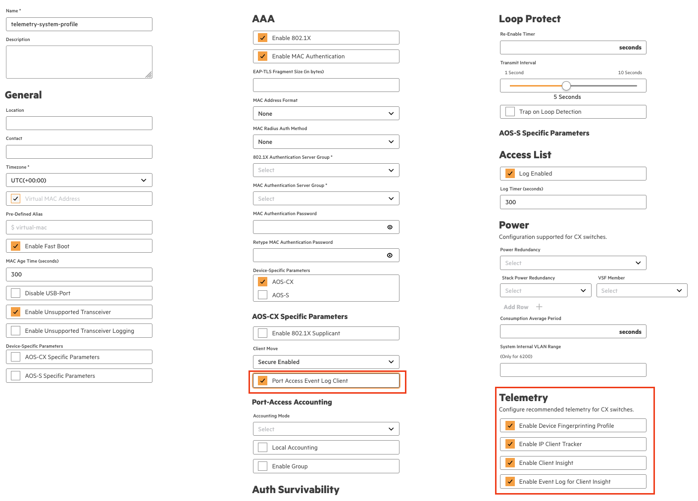

#### Configuration Push Switch System Profile

The following configuration will be pushed to the switch. You can validate this in the *CLI Viewer*, *Aruba Central Audit Trail* or on the switch CLI.

```text
client track ip 
client track ip all-vlans 
client device-fingerprint profile dfp_default
    lldp
    cdp
    dhcp
    http user-agent
client device-fingerprint apply-profile dfp_default
client-insight enable
client-insight event-log client-onboarding
port-access event-log client
```

#### Result in Aruba Central

Within Aruba Central, the following information is displayed after configuring the generic telemetry knobs.

| Configuration Knob | Result in Central |
| --- | --- |
| **Enable Device Fingerprinting Profile** | Client classification information and hostname |
| **Enable IP Client Tracker** | Client IP address |
| **Enable Client Insight** | Onboarding information in the Connectivity card |
| **Enable Event Log for Client Insight** | Onboarding information in Events |
| **Port Access Event Log Client** | Port authentication information in Events |

**IP, Hostname and Classification information**
To view hostname and classification information, navigate to:

```text
Aruba Central → Monitoring → Site → Clients → Select a client
```

On the client page, the telemetry is displayed.

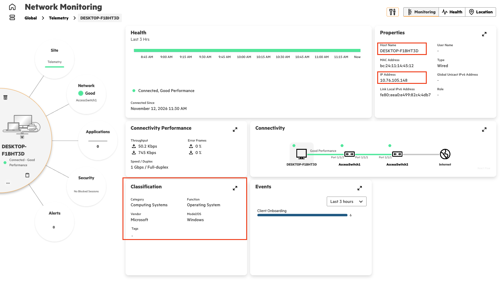

**Port Access Information**
Port Access Event Log sends authentication event information to Central. In Central, authentication and authorization information for 802.1X and MAC authentication events is shown. This works with Central NAC and with other NAC platforms like ClearPass.

To view information about Port Access events, navigate to:

```text
Aruba Central → Monitoring → Site → Clients → Select a client
```

On the client page, expand the *Connectivity* card. The authentication information in this card is displayed when **Client Insight** is enabled. DHCP and DNS onboarding information is discussed later.

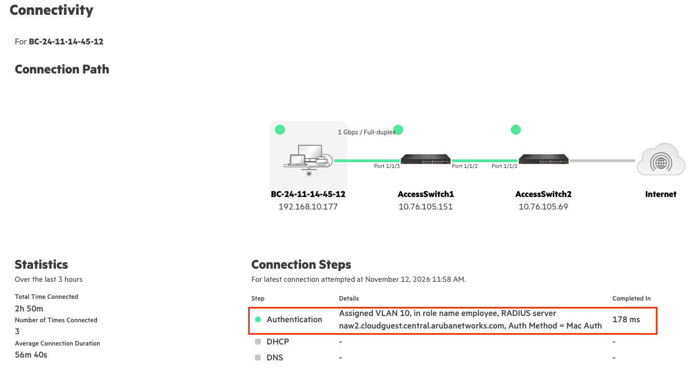

In *Events*, additional information is available when **Port Access Event Log Client** is enabled.

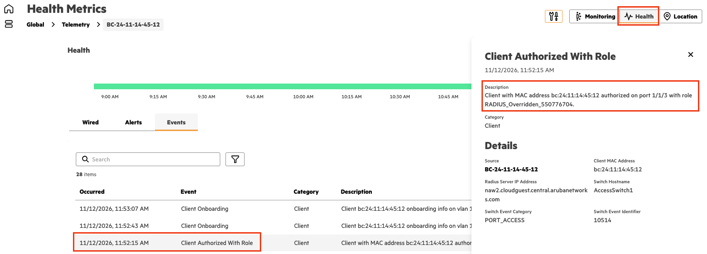

---

### DHCP Telemetry

This paragraph explains how to enable DHCP telemetry knobs. After enabling DHCP telemetry, client DHCP information is displayed in Aruba Central. DHCP Snooping is used to collect DHCP information. It is a security feature, but it is also used as a telemetry feature.

The following features are enabled with this configuration.

- DHCP Snooping Trust
- DHCP Snooping v4/v6
- DHCP Event Logs

> [!CAUTION]
> Make sure to configure DHCP Snooping Trust for uplink interfaces where DHCP responses are received. If this is not configured, DHCP responses are dropped and clients will not receive an IP address. DHCP Snooping trusted ports are configured in the Switch Interface Configuration or Port Profile.

#### Enable DHCP Snooping Trust on uplinks

DHCP Snooping Trust needs to be enabled on interfaces where DHCP responses are received.
DHCP Snooping Trust is an interface-level configuration. Configuration can be done directly on interfaces or via Port Profiles. In general, using Port Profiles is good practice, but it is not mandatory.

In this example, a Port Profile is used and applied to the uplink interface.

Navigate to:

```text
Aruba Central → Configuration → Interfaces → Port Profile
```

Optional: *for configuration directly on the interface*

```text
Aruba Central → Device → Configuration → Interfaces → Switch Interface Configuration
```

Create a new (uplink) Port Profile (or edit an existing one) and assign the profile to the right *scope* and *Device Function*. Assign the Port Profile to the uplink interfaces.

Configure the profile with the following information.

| Parameter | Value |
| --- | :-: |
| **DHCPv4 Snooping Trust** | ✅ |
| **DHCPv6 Snooping Trust** | ✅ |

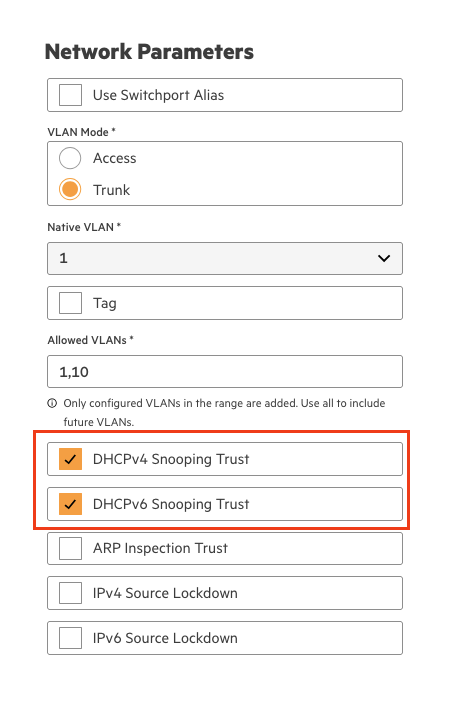

#### DHCP Snooping Profile

This section explains how to enable DHCP Snooping globally on switches.

Navigate to:

```text
Aruba Central → Configuration → Network Services → DHCP Snooping
```

Create a new DHCP Snooping Profile (or edit an existing one) and assign the profile to the right *scope* and *Device Function*.

Configure the profile with the following information.

##### DHCPv4 Snooping section

| Parameter | Value |
| --- | :-: |
| **Enable DHCPv4 Snooping** | ✅ |
| **Event Log** | ✅ |

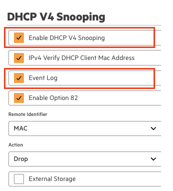

##### DHCPv6 Snooping section

| Parameter | Value |
| --- | :-: |
| **Enable DHCPv6 Snooping** | ✅ |
| **Event Log** | ✅ |

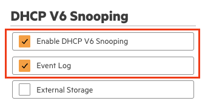

> [!TIP]
> The Trusted IPv4/IPv6 Servers are optional. Configure them only if you want to verify the DHCP server's IP address.

#### Enable DHCP Snooping per VLAN

After enabling DHCP Snooping globally, you must also enable DHCP Snooping per VLAN.

Navigate to:

```text
Aruba Central → Configuration → VLANs & Networks → VLAN
```

Update the VLANs where DHCP snooping is required. Configure each VLAN with the following settings.

##### VLAN Switch Parameters section

| Parameter | Value |
| --- | :-: |
| **DHCPv4 Snooping** | ✅ |
| **DHCPv6 Snooping** | ✅ |

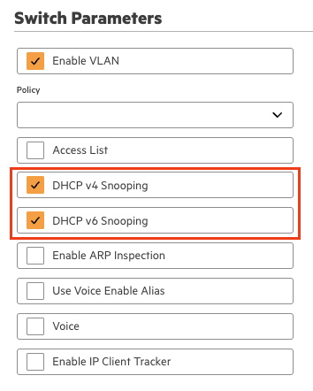

#### Configuration Push DHCP Telemetry

The following configuration will be pushed to the switch. You can validate this in the *CLI Viewer*, *Aruba Central Audit Trail* or on the switch CLI.

```text
##DHCP Snooping Trust on uplinks
interface 1/1/1
    dhcpv4-snooping trust
    dhcpv6-snooping trust

##DHCP Snooping global switch configuration
dhcpv4-snooping
dhcpv4-snooping event-log client
dhcpv6-snooping
dhcpv6-snooping event-log client

##DHCP Snooping per VLAN
vlan 10
    dhcpv4-snooping
    dhcpv6-snooping
```

#### DHCP Telemetry results in Aruba Central

Within Aruba Central, the following information is displayed at client level after configuring DHCP telemetry knobs.

| Configuration Knob | Result in Central |
| --- | --- |
| **DHCP Snooping (Global and per VLAN)** | DHCP information in the Client Connectivity card |
| **DHCP Snooping Event Log** | DHCP logs in Events |

**Client connectivity details**
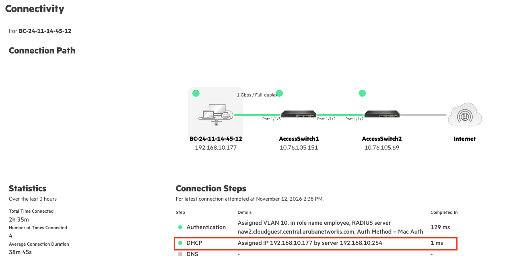

**Client DHCP Events**
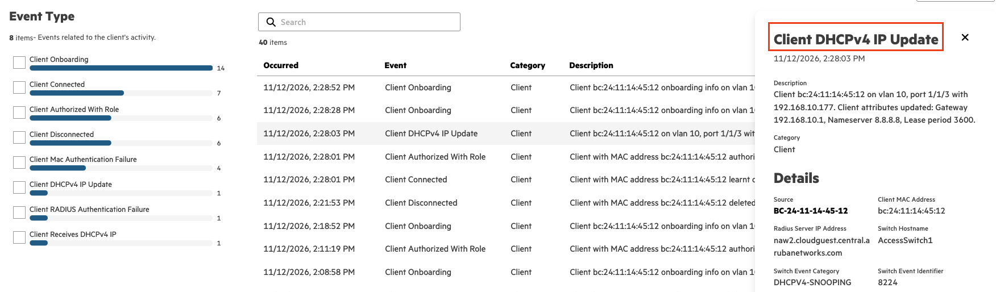

### Application Visibility and Flow Telemetry

This section explains how to enable Application Visibility and Flow Telemetry. After enabling Application Recognition and Flow Telemetry, Aruba Central displays the applications used by clients.

The following features are enabled with this configuration:

- Traffic Insight and IPFIX
- Application Visibility (ARC)

> [!TIP]
> As described earlier, this feature only applies to the CX-5420, CX-6200, CX-6300F/M, and CX-6400v2 platforms.
> Some platforms in the 8000 series support visibility for well-known ports (no DPI). However, this how-to focuses on the access switch layer and does not cover the 8000 series.

The following configuration steps are required:

1. Enable App Recognition and Control (ARC) globally on the switch
1. Enable Flow Telemetry on the switch uplinks
1. Enable Flow Telemetry and Application Recognition on the downlinks

> [!CAUTION]
> Do not enable Application Recognition on the switch uplinks!

#### Enable App Recognition and Control Globally

This section explains how to enable Application Recognition and Control on the switch.

Navigate to:

```text
Aruba Central → Configuration → Application Experience → App Recognition and Control
```

Create a new App Recognition and Control profile (or edit an existing one) and assign it to the appropriate *scope* and *Device Function*.

Configure the profile with the following information.

| Parameter | Value |
| --- | :-: |
| **Enable Application Recognition** | ✅ |
| *Under Switch Specific Parameters* | &#xfeff; |
| **Limit Exceed** | Log Only |

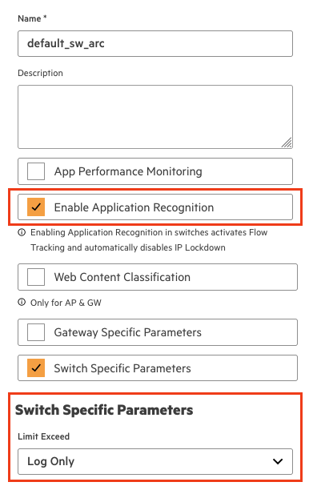

> [!NOTE]
> With the **Limit Exceed** option set to **Log Only**, warnings are logged if the session table is full. ABP inspection is not performed, and new traffic flows are not dropped.

#### Flow Telemetry Uplink

Before application information is visible in Aruba Central, Flow Telemetry must be enabled. IPFIX forwards the application information to Aruba Central. This setting is only available in Port Profiles.

Navigate to:

```text
Aruba Central → Configuration → Interfaces → Port Profile
```

Create a new uplink Port Profile (or edit an existing one) and assign it to the appropriate *scope* and *Device Function*. Then assign the profile to the uplink interfaces.

Configure the profile with the following information.

##### Telemetry section uplink Port Profile

| Parameter | Value |
| --- | :-: |
| **Enable Flow Telemetry for Central** | ✅ |

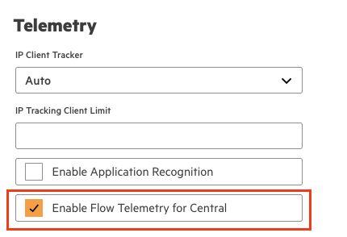

#### ARC and Flow Telemetry Downlinks

On downlink (access) ports, enable Application Recognition and Flow Telemetry. These options are currently available in Port Profiles.

Navigate to:

```text
Aruba Central → Configuration → Interfaces → Port Profile
```

Create a new downlink Port Profile (or edit an existing one) and assign it to the appropriate *scope* and *Device Function*. Then assign the profile to the downlink interfaces.

Configure the profile with the following information.

##### Telemetry section downlink Port Profile

| Parameter | Value |
| --- | :-: |
| **Enable Application Recognition** | ✅ |
| **Enable Flow Telemetry for Central** | ✅ |

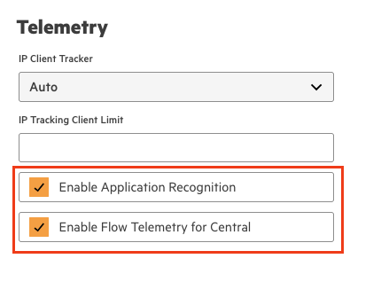

#### Configuration Push Application Visibility and Flow Telemetry

The following configuration will be pushed to the switch. You can validate this in the *CLI Viewer*, *Aruba Central Audit Trail* or on the switch CLI.

```text
### Application Recognition Profile
no ip source-lockdown resource-extended
flow-tracking
    enable
app-recognition
    enable
    abp-session-limit-exceed-action log-only

### Flow Telemetry Configuration
flow exporter sys_cx_exporter_local_default
    description Default Flow Exporter with internal destination used in telemetry config
    destination type traffic-insight
    destination traffic-insight sys_cx_ti_instance_default
    template data timeout 60
flow record sys_cx_record_v4_default
    description Default IPv4 Flow Record used in telemetry config
    match ipv4 destination address
    match ipv4 protocol
    match ipv4 source address
    match ipv4 version
    match transport destination port
    match transport source port
    collect application dns response-code
    collect application https url
    collect application name
    collect application tcp establishment-time
    collect application tls-attributes
    collect counter bytes
    collect counter packets
    collect egress interface
    collect egress queue
    collect egress vlan
    collect forwarding-status
    collect timestamp absolute first
    collect timestamp absolute last
flow record sys_cx_record_v6_default
    description Default IPv6 Flow Record used in telemetry config
    match ipv6 destination address
    match ipv6 protocol
    match ipv6 source address
    match ipv6 version
    match transport destination port
    match transport source port
    collect application dns response-code
    collect application https url
    collect application name
    collect application tcp establishment-time
    collect application tls-attributes
    collect counter bytes
    collect counter packets
    collect egress interface
    collect egress queue
    collect egress vlan
    collect forwarding-status
    collect timestamp absolute first
    collect timestamp absolute last
flow monitor sys_cx_monitor_v4_default
    description Default IPv4 Flow Monitor used in telemetry config
    exporter sys_cx_exporter_local_default
    record sys_cx_record_v4_default
flow monitor sys_cx_monitor_v6_default
    description Default IPv6 Flow Monitor used in telemetry config
    exporter sys_cx_exporter_local_default
    record sys_cx_record_v6_default
flow-tracking
    enable
traffic-insight sys_cx_ti_instance_default
    enable
    source ipfix
    monitor sys_cx_app_monitor_default type application-flows 
    monitor sys_cx_dns_avg_latency_default type dns-average-latency 
    monitor sys_cx_dns_onbd_latency_default type dns-onboarding-latency 
    monitor sys_cx_raw_monitor_default type raw-flows 

###Uplink interface
interface 1/1/x
    ip flow monitor sys_cx_monitor_v4_default in
    ipv6 flow monitor sys_cx_monitor_v6_default in

###Downlink interface
interface 1/1/x
    app-recognition enable
    ip flow monitor sys_cx_monitor_v4_default in
    ipv6 flow monitor sys_cx_monitor_v6_default in
```

#### Application Visibility and Flow Telemetry in Aruba Central

After enabling Application Visibility and Flow Telemetry, the following information is displayed in Aruba Central:

- Application Visibility
- DNS onboarding information in the Connection Path card

**Application Visibility**
Applications are displayed in Aruba Central at the global, site, device, and client levels.

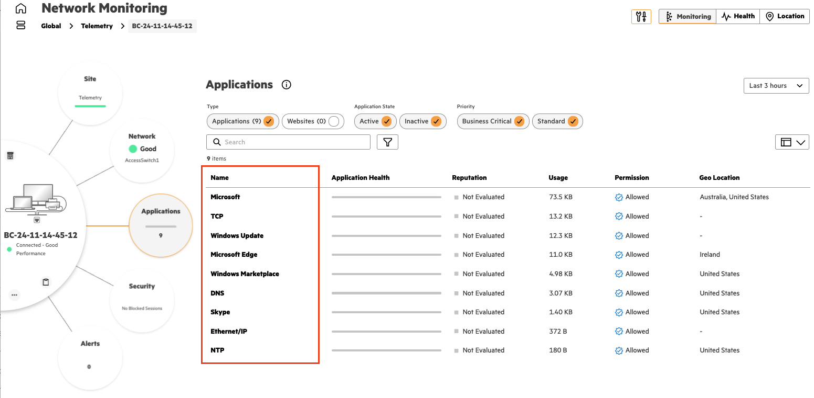

**DNS onboarding information**
After enabling Flow Telemetry, DNS onboarding information is displayed in the Connection Path card at the client level. This helps network administrators see the steps each client takes during onboarding.

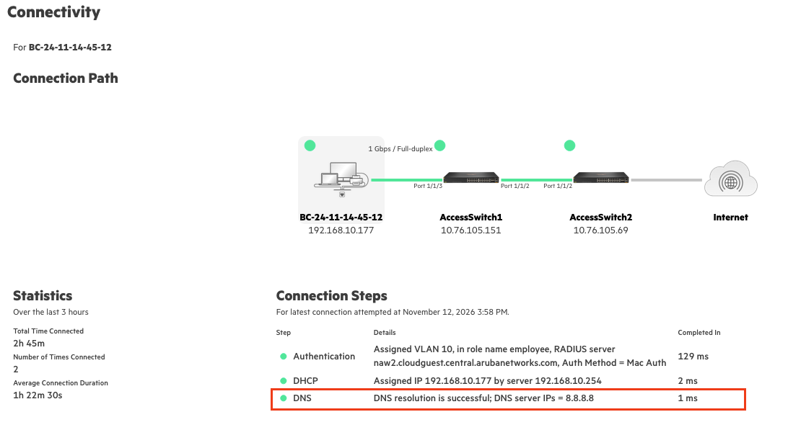

## References

- [Aruba Central documentation](https://arubanetworking.hpe.com/techdocs/new-central/content/home.htm)
- [Aruba Switch Feature Navigator](https://feature-navigator.arubanetworking.hpe.com/wired?mode=explore)
- [Traffic Insight support platforms](https://support.hpe.com/hpesc/public/docDisplay?docId=sd00007924en_us&page=GUID-11CA1A71-34A4-4284-9530-4CE0CE8F6904.html)